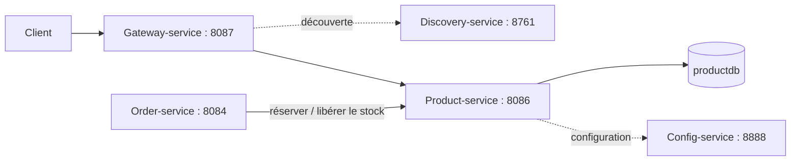

# Product-service

Product-service gère le petit catalogue de démonstration du projet : catégories, produits, prix et stock.
Il écoute sur le port `8086`, charge sa configuration depuis Config-service et s'enregistre dans Eureka.

## Pourquoi ce périmètre reste simple

Le cahier des charges complet prévoit aussi les variantes, médias S3, Elasticsearch, promotions, avis et
stock multi-entrepôts. Ces fonctions sont volontairement laissées pour une version future. Le MVP montre
d'abord le rôle d'un microservice autonome et ses liens avec Gateway-service et Order-service.



## Modèle

- `Category` : nom, description et catégorie parente optionnelle.
- `Product` : nom, description, marque, SKU unique, prix, stock, statut et catégorie.
- `ProductStatus` : `DRAFT`, `PUBLISHED` ou `ARCHIVED`.

Chaque produit appartient à une catégorie. Un produit est disponible lorsqu'il est publié et que son stock
est supérieur à zéro.

## API

| Méthode | Route | Fonction |
| --- | --- | --- |
| POST | `/api/categories` | Créer une catégorie |
| GET | `/api/categories` | Lister les catégories |
| GET | `/api/categories/{id}` | Consulter une catégorie |
| PUT | `/api/categories/{id}` | Modifier une catégorie |
| DELETE | `/api/categories/{id}` | Supprimer une catégorie inutilisée |
| POST | `/api/products` | Créer un produit |
| GET | `/api/products` | Lister les produits |
| GET | `/api/products?search=ordinateur` | Recherche simple |
| GET | `/api/products/{id}` | Consulter un produit |
| PUT | `/api/products/{id}` | Modifier un produit |
| PATCH | `/api/products/{id}/stock/reserve` | Réserver du stock |
| PATCH | `/api/products/{id}/stock/release` | Libérer du stock |
| DELETE | `/api/products/{id}` | Supprimer un produit |

Exemple de produit :

```json
{
  "name": "Laptop Pro",
  "description": "Ordinateur de démonstration",
  "brand": "DemoBrand",
  "sku": "LAP-001",
  "price": 899.90,
  "stockQuantity": 10,
  "status": "PUBLISHED",
  "categoryId": 1
}
```

Réservation de deux unités :

```json
{
  "quantity": 2
}
```

## Liens avec les autres microservices

1. Le client appelle `http://localhost:8087/product-service/api/products` via Gateway-service.
2. Gateway-service trouve Product-service par son nom dans Eureka, sans adresse IP codée en dur.
3. Dans une prochaine version, Order-service appellera l'endpoint `stock/reserve` avant de confirmer une
   commande et `stock/release` si la commande ou le paiement échoue.
4. Product-service possède sa propre base `productdb`. Aucun autre service n'accède directement à ses tables.

## Démarrage local

Créer une base PostgreSQL `productdb` et un utilisateur `product_app`, puis définir le mot de passe :

```powershell
$env:PRODUCT_DB_PASSWORD="votre-mot-de-passe"
.\mvnw.cmd spring-boot:run -Dspring-boot.run.profiles=local
```

Pour l'architecture complète, démarrer Eureka, Config-service et Gateway-service avant Product-service.

## Tests

Les tests utilisent une base H2 en mémoire et ne nécessitent pas PostgreSQL :

```powershell
.\mvnw.cmd test
```
