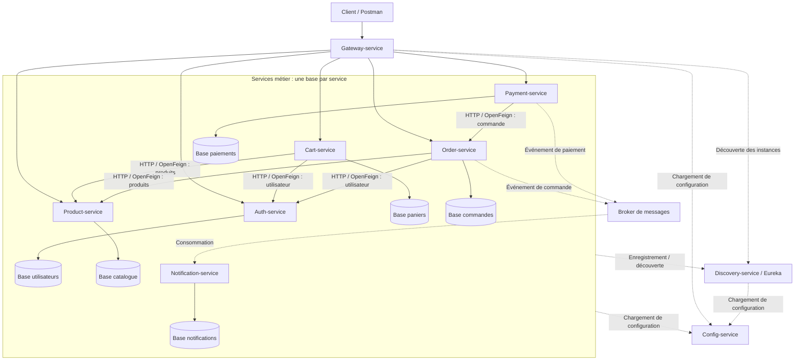
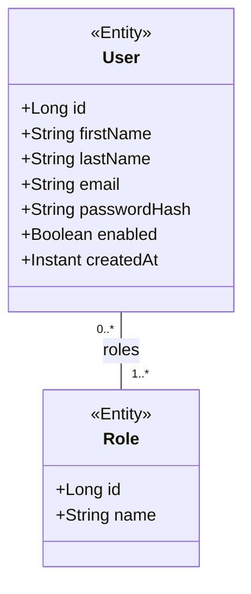
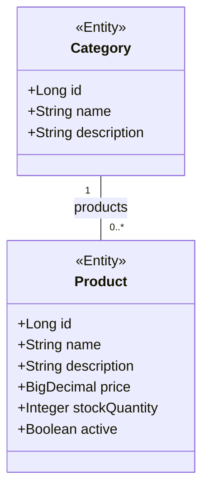
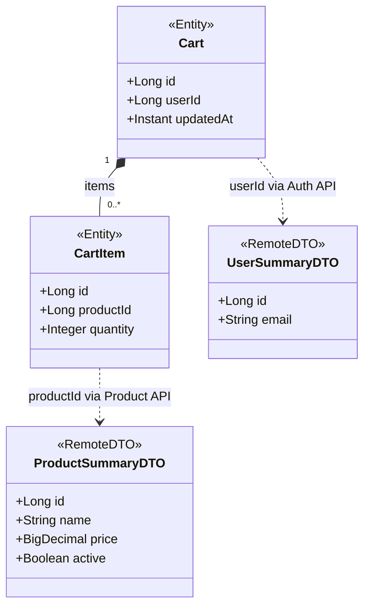
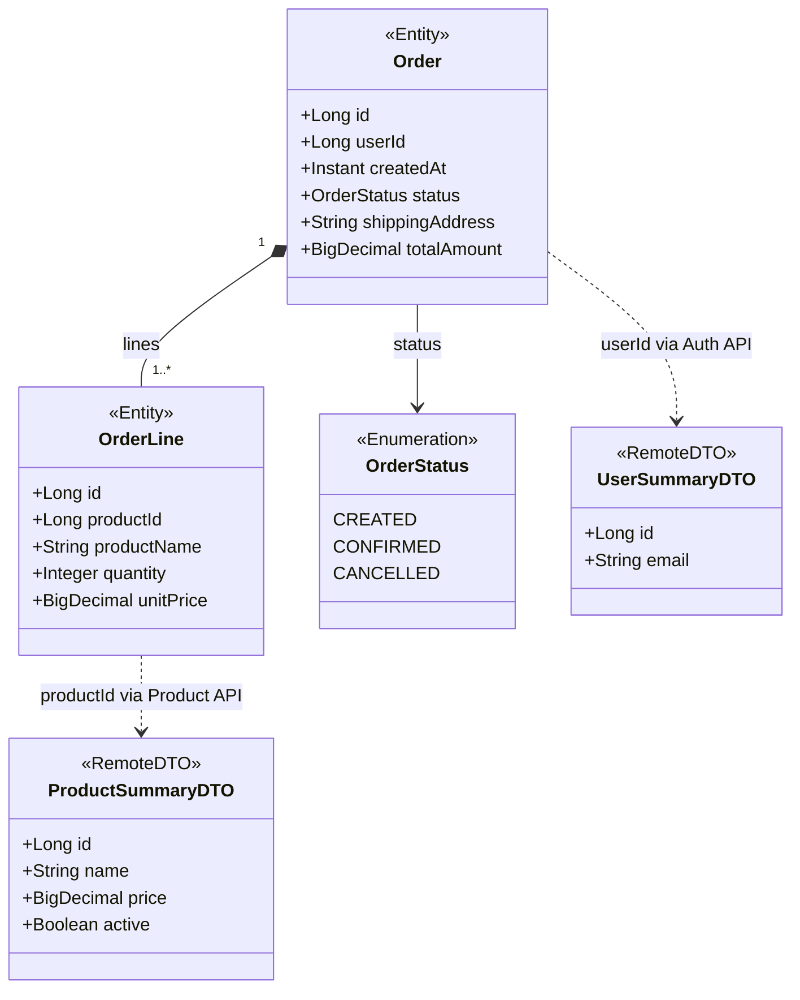
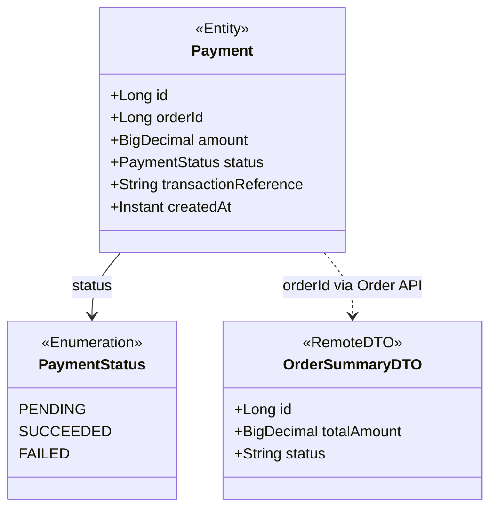
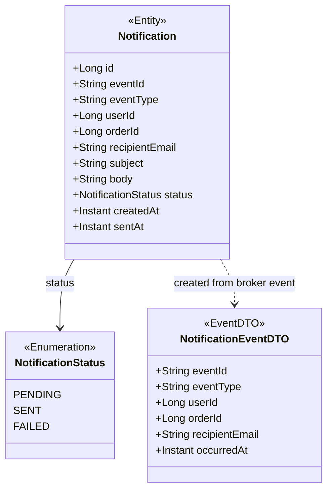
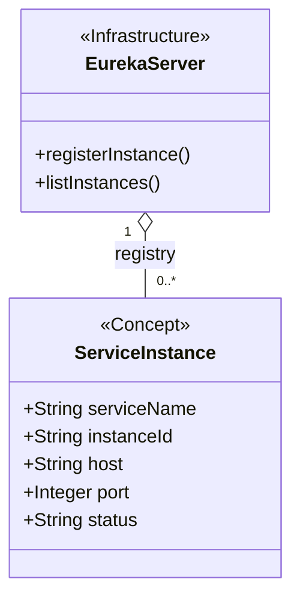
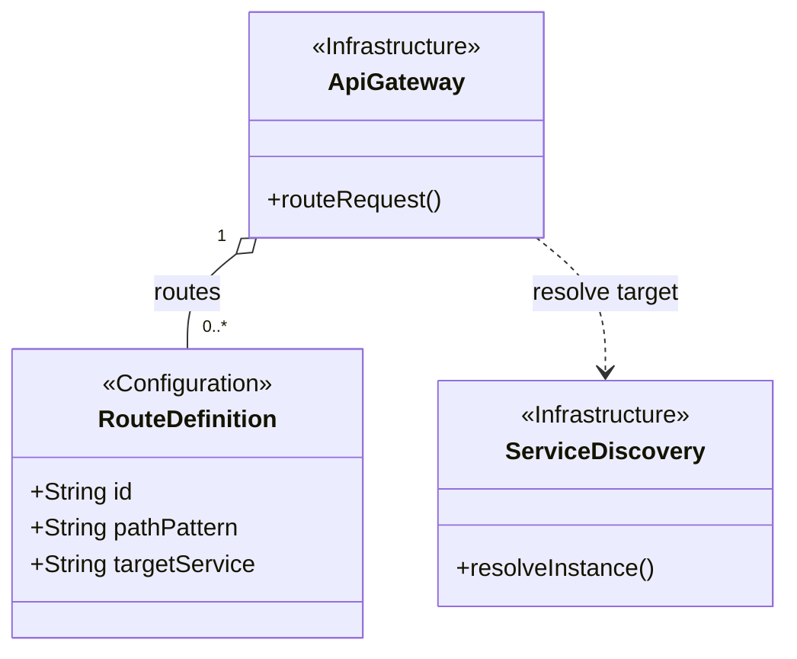
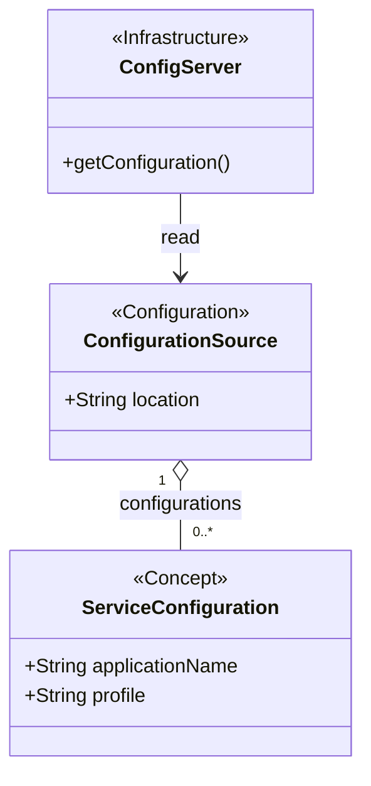

# Architecture et diagrammes de classes — V0

Ce document décrit la conception cible du projet e-commerce. Les classes, les communications et les bases représentées sont proposées pour les prochaines étapes ; leur présence dans ce document ne signifie pas qu'elles sont déjà implémentées.

## 1. Périmètre des services

| Service | Responsabilité | Données possédées |
| --- | --- | --- |
| Auth-service | Comptes utilisateurs et authentification | Utilisateurs et rôles |
| Product-service | Catalogue des produits et catégories | Produits et catégories |
| Cart-service | Paniers et articles du panier | Paniers et articles |
| Order-service | Gestion des commandes | Commandes et lignes de commande |
| Payment-service | Gestion des paiements | Paiements |
| Notification-service | Envoi et suivi des notifications | Notifications |
| Discovery-service | Annuaire Eureka des instances | Aucune donnée métier |
| Gateway-service | Point d'entrée et routage des requêtes | Aucune donnée métier |
| Config-service | Distribution des configurations | Fichiers de configuration |

Order-service gère les commandes. Les paiements et l'envoi des notifications restent sous la responsabilité de leurs services respectifs.

## 2. Architecture globale

Les flèches HTTP entre services représentent les appels synchrones prévus pour V4. Les échanges par broker sont prévus pour V5 ; le choix RabbitMQ ou Kafka reste à confirmer. Les dépendances Eureka, Gateway et Config Server sont documentées en V0 et seront vérifiées lors de V2/V3.

Le diagramme décrit les dépendances logiques. Les appels HTTP ne donnent aucun accès direct à la base du service appelé. La Gateway découvre les services dans Eureka et leur transmet les requêtes. Notification-service consomme les événements du broker ; aucune route publique vers ce service n'est nécessaire dans cette proposition.

## 3. Règles des modèles

- Chaque service métier possède sa base ; aucune table n'est partagée entre services.
- Une association JPA n'est autorisée qu'entre entités du même service.
- Une référence distante est un identifiant simple (`userId`, `productId` ou `orderId`), sans clé étrangère vers une autre base et sans `@ManyToOne` interservice.
- Lors d'une création dépendant d'un autre service, le service propriétaire de la référence est interrogé avant l'enregistrement. Ces vérifications seront implémentées en V4.
- Les réponses distantes sont représentées par des DTO, jamais par des entités JPA importées d'un autre service.
- Les montants utilisent `BigDecimal`. Les quantités doivent être positives et les montants non négatifs. Les validations et DTO de requête seront détaillés en V1.
- Les classes ci-dessous décrivent les données métier principales. Les couches Repository, Service et Controller seront ajoutées en V1.

## 4. Auth-service

`User` et `Role` appartiennent à la base d'Auth-service. Un utilisateur possède au moins un rôle ; un rôle peut être attribué à plusieurs utilisateurs. L'adresse email est unique. Seul le hash du mot de passe est conservé.

Les autres services utilisent `userId` pour référencer un utilisateur. Ils ne stockent ni son mot de passe ni une relation JPA vers `User`.

## 5. Product-service

Chaque produit appartient à une catégorie. Une catégorie peut contenir plusieurs produits. La gestion des réservations et de la décrémentation du stock n'est pas définie par ce modèle V0.

Cart-service et Order-service référencent un produit par `productId`. Ils vérifient son existence auprès de Product-service.

## 6. Cart-service

Un panier appartient à un utilisateur distant et contient zéro ou plusieurs articles locaux. Un produit ne peut figurer qu'une seule fois dans un même panier : la paire `(cartId, productId)` est unique. La conception prévoit un panier par utilisateur, avec `userId` unique.

La relation `Cart`–`CartItem` est locale. Les pointillés vers les DTO indiquent une résolution par API, sans persistance des DTO. Le prix affiché du panier provient de Product-service ; le prix définitif est figé lors de la création de la commande.

## 7. Order-service — Gestion des commandes

Une commande appartient à un utilisateur distant et contient au moins une ligne. Chaque ligne conserve le nom du produit et son prix unitaire au moment de la commande : une modification ultérieure du catalogue ne modifie pas l'historique.

`totalAmount` est calculé côté serveur : somme des `quantity × unitPrice` des lignes. Le prix est obtenu auprès de Product-service et ne doit pas être accepté aveuglément depuis le client.

Dans cette conception, la création reçoit les identifiants des produits et leurs quantités. Un panier peut fournir ces informations au client ; Order-service n'a donc pas besoin de relation persistante vers `Cart`. Order-service gère le cycle de la commande ; Payment-service possède le statut du paiement.

## 8. Payment-service

Un paiement référence une commande distante. Une commande peut avoir plusieurs tentatives de paiement ; chaque tentative possède son identifiant et son statut. Les détails d'un prestataire de paiement restent à définir lors de l'implémentation. Aucune donnée bancaire sensible n'est prévue dans ce modèle.

Avant la création d'un paiement, Payment-service vérifie l'existence de la commande, son état et son montant via Order-service. Le contrôle des paiements déjà réussis et l'idempotence seront précisés dans les étapes suivantes, notamment V6.

## 9. Notification-service

Ce service consomme les événements de commande et de paiement. Chaque événement fournit les informations nécessaires à l'envoi, dont l'email du destinataire. Notification-service peut ainsi traiter l'événement sans appel synchrone supplémentaire.

`userId` et `orderId` servent à la corrélation avec les services distants ; ce ne sont pas des associations JPA. Le contrat détaillé des événements sera défini en V5. `eventId` permet de reconnaître les livraisons répétées ; le traitement idempotent devra être implémenté explicitement.

## 10. Services techniques

Discovery-service, Gateway-service et Config-service n'ont pas d'entités métier. Les diagrammes suivants représentent leurs composants conceptuels, pas des classes Java à créer dans le projet.

### Discovery-service

### Gateway-service

### Config-service

La source des configurations (répertoire local ou dépôt Git) et les routes de la Gateway seront précisées dans les instructions de démarrage. Aucun diagramme technique ci-dessus ne suppose la création d'une base métier pour ces services.

## 11. Synthèse des références distantes

| Service propriétaire | Champ | Service référencé | Résolution prévue |
| --- | --- | --- | --- |
| Cart-service | `Cart.userId` | Auth-service | API via OpenFeign |
| Cart-service | `CartItem.productId` | Product-service | API via OpenFeign |
| Order-service | `Order.userId` | Auth-service | API via OpenFeign |
| Order-service | `OrderLine.productId` | Product-service | API via OpenFeign ; nom et prix figés dans la ligne |
| Payment-service | `Payment.orderId` | Order-service | API via OpenFeign |
| Notification-service | `Notification.userId` | Auth-service | Identifiant reçu dans l'événement ; aucune jointure distante |
| Notification-service | `Notification.orderId` | Order-service | Identifiant reçu dans l'événement ; aucune jointure distante |

## 12. Suite de la V0

Ce document fournit le schéma global et les diagrammes de classes proposés. Le livrable V0 doit encore être complété par un `README.md` décrivant les prérequis vérifiés, la structure du dépôt et les instructions d'installation et de démarrage, en distinguant l'état actuel de la conception cible.
